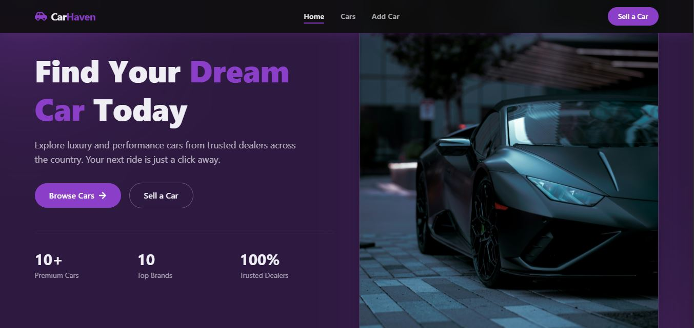

# Car Haven

A dark-themed, purple-accented  car listings web app. Browse featured cars, open a full listing, and manage your own: add a car with a photo from your device, edit it, or delete it.

**Live demo:** https://car-haven-sandy.vercel.app



## Features

- **Browse cars:** a featured section on the home page and a full listings page
- **Car details:** large photo, key specs (year, mileage, transmission, fuel type), description, and dealer contact (call or email)
- **Add a car:** a form with all listing fields, including dealer info and a photo upload from your device (with a live preview)
- **Edit a car:** update any listing from its detail page
- **Delete a car:** removal behind a custom confirmation dialog
- **Image handling:** photos are resized and compressed in the browser before saving
- **Feedback:** loading spinners, success and error toasts, and a themed 404 page
- **Responsive:** works on phones, tablets and desktops

## Tech stack

| Area | Tools |
| --- | --- |
| Frontend | React, Vite, React Router |
| Styling | Tailwind CSS |
| UI extras | React Icons, React Toastify |
| Backend (mock API) | json-server, hosted on Render |
| Hosting | Vercel (frontend), Render (API) |

## How it works

The frontend calls `/api/...` and Vercel forwards those requests to the json-server API on Render (see `vercel.json`). In local development, the Vite proxy forwards `/api` to json-server on port 8000.

Car objects look like this:

```json
{
  "id": "1",
  "title": "BMW M8 Competition Coupe",
  "type": "BMW",
  "location": "Lagos, Nigeria",
  "description": "Condition, features, service history",
  "price": "$134,100",
  "image": "/images/bmw-m8.JPG",
  "year": 2023,
  "mileage": "12,000 km",
  "transmission": "Automatic",
  "fuelType": "Petrol",
  "company": {
    "name": "Dealership name",
    "description": "About the dealership",
    "contactEmail": "dealer@example.com",
    "contactPhone": "+234 000 000 0000"
  }
}
```

## Getting started

### Prerequisites

- Node.js 18 or newer
- npm

### Run locally

```bash
# 1. Clone the repo
git clone https://github.com/IbnAbass1401/Car-Haven.git
cd Car-Haven

# 2. Install dependencies
npm install

# 3. Start the mock API (terminal 1), runs on http://localhost:8000
npm run server

# 4. Start the app (terminal 2), runs on http://localhost:5173
npm run dev
```

If a port is already in use, stop the old process (or change the port in `package.json` and the proxy in `vite.config.js`) and restart.

### Scripts

| Command | What it does |
| --- | --- |
| `npm run dev` | Start the Vite dev server |
| `npm run server` | Start json-server on port 8000 |
| `npm run build` | Build for production |
| `npm run preview` | Preview the production build |

## Project structure

```
src/
  components/   Navbar, Hero, CarListings, CarListing, Spinner, ConfirmModal...
  layouts/      MainLayout
  pages/        HomePages, CarsPage, CarPage, AddCarPage, EditCarPage, NotFoundPage
  App.jsx       Routes and API handlers (add, update, delete)
```

## Routes

| Path | Page |
| --- | --- |
| `/` | Home |
| `/cars` | All cars |
| `/cars/:id` | Car details |
| `/add-car` | Add a car |
| `/edit-car/:id` | Edit a car |
| `*` | 404 |

## Known limitations

- The free Render plan sleeps when idle, so the first request can take up to a minute. It also resets `db.json` on restart, so cars added on the live site can disappear.
- There is no authentication, so anyone can add, edit or delete listings.

## Author

**Abass A.**


